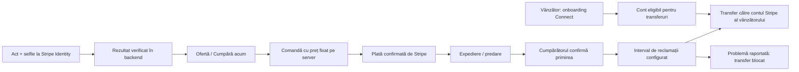

# Stripe pentru Pinbind: identitate și marketplace

## Decizia de produs

Model confirmat: cumpărătorul plătește, vânzătorul primește suma după livrare, Pinbind reține comisionul. Implementarea din această etapă este backend pentru sandbox, dezactivată implicit. Rulează cu MongoDB-ul configurat în `MONGODB_URI`, inclusiv cloud Atlas; baza locală este necesară doar testelor automate de integrare. Ghidul de server este în [backend-server-stripe.md](backend-server-stripe.md). Aplicația Flutter are acum PaymentSheet, verificare Identity, onboarding Connect și ecrane de comenzi; vezi [ghidul mobil](stripe-mobile-testing.md). Site-ul nu are încă formularul Stripe. Cheile live sunt refuzate explicit. Anunțurile existente nu sunt migrate automat. Pregătirea cloud adaugă numai colecțiile și indexurile commerce.



Transferul în contul Stripe al vânzătorului și plata din acel cont în bancă sunt operații diferite. Starea `completed` din MVP indică transferul către contul Connect; nu confirmă intrarea banilor în contul bancar.

## De ce acest model

[Catawiki descrie verificarea datelor de încasare, plata devenită eligibilă după livrare și blocarea plății când apare o reclamație](https://www.catawiki.com/en/help/payment-status/when-and-how-will-i-receive-payment-for-an-object-i-sold). Preluăm separarea etapelor, nu comisioanele sau termenele sale.

[Vinted descrie propriul Vinted Pay ca serviciu de plată cu licență, alături de colaborarea cu alți furnizori de plăți](https://company.vinted.com/newsroom/vinted-pay). Lecția pentru Pinbind este să folosim infrastructura reglementată a providerului; un câmp `balance` în MongoDB nu reproduce un portofel financiar. Nu preluăm condițiile dintr-o altă țară ca reguli pentru România.

[Stripe Connect separă încasarea platformei de transferurile către vânzători](https://docs.stripe.com/connect/separate-charges-and-transfers). Acest flux se potrivește cu deblocarea după livrare. Costurile procesării, refund-urile și riscul de chargeback ale acestui model trebuie bugetate de platformă și reflectate în contractele comerciale.

Un hold pe card pe întreaga durată a licitației nu este baza sistemului: [autorizările au termene de expirare variabile](https://docs.stripe.com/payments/place-a-hold-on-a-payment-method). Versiunea mobilă solicită explicit garanția rambursabilă de 10% înainte de ofertă și plata restului după rezervare/câștigare. Nu debitează automat carduri fără participarea utilizatorului. Garanția se restituie celor care pierd și se scade din prețul câștigătorului, conform ghidului mobil.

[Stripe precizează că nu oferă servicii de escrow](https://docs.stripe.com/connect/manual-payouts). Produsul va descrie corect transferurile amânate. Tipul entității Pinbind, țările acceptate și termenii marketplace-ului trebuie să fie compatibili cu configurația aprobată de Stripe.

## Identity: act și selfie

- Backend-ul creează o `VerificationSession` cu `type=document`, acte `id_card`/`passport` și `require_matching_selfie=true`.
- [Stripe documentează comparația dintre fotografia actului și selfie, inclusiv disponibilitatea pentru documente din România](https://docs.stripe.com/identity/verification-checks?type=selfie). Acceptarea exactă a unui act depinde de Stripe; aplicația nu promite acceptarea oricărui model de buletin.
- Captura are loc în pagina găzduită de Stripe. Backend-ul nu primește imaginile și nu le trimite în S3. Se păstrează referința sesiunii, statusul, data verificării și un cod de eroare.
- URL-ul temporar este returnat doar utilizatorului autentificat, cu `private, no-store`; nu se stochează și nu se loghează. [Sesiunea este reutilizată la reluare și crearea folosește o cheie de idempotență](https://docs.stripe.com/identity/verification-sessions).
- Redirectul nu verifică utilizatorul. Rezultatul este citit din Stripe și aplicat din webhook/reconciliere. Sesiunile fără verificarea selfie cerută nu primesc starea verificată.
- Onboarding-ul Connect rămâne separat. [Verificările necesare beneficiarilor plăților au cerințe proprii](https://docs.stripe.com/connect/identity-verification); o bifă Identity nu este folosită ca substitut pentru eligibilitatea încasărilor.
- Înainte de activare pentru utilizatori: flux de informare privind biometria, opțiune alternativă potrivită, politică de retenție și proces pentru solicitările de ștergere. Acestea sunt semnalate și în documentația Stripe pentru selfie. [Stripe oferă redactarea datelor sesiunii](https://docs.stripe.com/api/identity/verification_sessions/redact); MVP-ul nu are încă un endpoint de ștergere/redactare și necesită procedură de suport.

## Ce este implementat în backend

SDK-ul oficial Stripe este fixat în lockfile. `CommerceModule` separă:

- `CommerceAccountsService`: status identitate, sesiune document+selfie, onboarding Express pentru vânzători din România și verificarea capabilităților curente.
- `CommerceOrdersService`: snapshot în bani întregi RON, plată, expediere, confirmare de primire numai de către cumpărător, reclamație, refund integral administrativ înainte de transfer, transfer amânat și stări de revizuire.
- `CommerceWorker`: închidere durabilă a licitațiilor financiare, coadă Mongo pentru webhook-uri, retry, reconcilierea plăților, expirare și transferuri în loturi limitate.
- `CommerceLockService`: lease Mongo pe operație, cu proprietar și heartbeat. Cheile Stripe persistente completează controlul concurenței.

Prețul, comisionul și suma vânzătorului sunt calculate exclusiv pe server și fixate la creare. `amount = fee + sellerAmount`; taxa este dedusă din suma vânzătorului, iar cumpărătorul plătește prețul produsului. Taxe de transport, TVA, taxă distinctă pentru cumpărător și conversii valutare nu sunt încă modelate și nu sunt inventate. Nu există portofel intern sau sold bancar fictiv.

Prețul afișat la închiderea licitației este folosit pentru plată, nu maximul privat introdus de cumpărător. Un maxim care îndeplinește rezerva ridică prețul public cel puțin la rezervă. O licitație fără ofertant eligibil sau fără rezervă atinsă expiră fără comandă și fără plată.

Pentru anunțurile financiare noi (`commerceVersion=1`), publicarea necesită rol aprobat și cont neblocat; Connect este cerut la eliberarea încasărilor, iar licitarea și cumpărarea imediată cer identitate verificată. Anunțurile vechi nu sunt înscrise automat în acest flux. Rezervările vechi necesită revizuire, nu o debitare retroactivă.

## API

Toate rutele de utilizator cer JWT; identitatea și rolul sunt citite din utilizatorul validat în baza de date.

| Rută | Utilizare |
| --- | --- |
| `GET /commerce/me` | Status propriu Identity și Connect, fără datele documentului |
| `POST /commerce/identity/session` | Creare/reluare verificare proprie |
| `POST /commerce/seller/onboarding` | Link temporar de onboarding, numai vânzător/admin eligibil; body `businessType: individual/company` |
| `GET /commerce/orders` | Ultimele 50 de comenzi proprii, ca vânzător sau cumpărător |
| `POST /commerce/products/:id/order` | Creează/returnează comanda rezervării proprii |
| `POST /commerce/orders/:id/payment` | PaymentIntent al cumpărătorului, cu sumă din snapshot |
| `POST /commerce/orders/:id/shipment` | Vânzătorul adaugă `carrier`, `trackingCode`, după plată |
| `POST /commerce/orders/:id/receipt` | Cumpărătorul confirmă primirea; începe intervalul de reclamații |
| `POST /commerce/orders/:id/issues` | Cumpărătorul blochează transferul: `code` |
| `POST /commerce/orders/:id/refund` | Admin: refund integral înainte de transfer, cu `reason` și actor salvat |
| `GET /commerce/review-queue` | Admin: comenzi cu probleme/revizuire |
| `POST /commerce/webhooks/stripe` | Webhook semnat pentru evenimentele contului platformei |
| `POST /commerce/webhooks/connect` | Webhook Connect semnat separat pentru `account.updated` |

Nu există rută prin care clientul să seteze `paid`, `verified`, suma sau beneficiarul transferului. Alegerea unui utilizator în corpul unei comenzi nu acordă drepturi asupra comenzii.

## Siguranță și procesare

- Webhook-urile folosesc corpul brut și semnătura Stripe. Chei de webhook distincte pentru platformă și Connect; evenimente live respinse în această etapă.
- [Stripe poate repeta și livra evenimentele în altă ordine](https://docs.stripe.com/webhooks). Inbox-ul are ID de eveniment unic, persistă înainte de răspuns și conține doar identificatori de rutare; nu salvează payload-ul cu date de identitate. Worker-ul recitește obiectul curent din Stripe.
- Suma, moneda, tentativa de plată și comanda sunt verificate la reconciliere. Înlocuirea configurației comisionului nu recalculează comenzile existente.
- Crearea unei sesiuni, a unui cont Connect sau a unei plăți folosește chei stabile. Creările rămase fără răspuns nu sunt repetate orbește după 20 de ore; cer reconciliere înainte de depășirea ferestrei providerului.
- Întâi se confirmă anularea plății, apoi se expiră comanda. Un succes deja produs este recunoscut chiar dacă mesajul ajunge târziu. Produsul nu se repune automat la vânzare și nu se oferă automat următorului participant.
- Expedierea nu deblochează bani. MVP-ul folosește confirmarea cumpărătorului; nu pretinde că un tracking introdus de vânzător dovedește livrarea. Integrarea cu un curier și procedura pentru cumpărătorul care nu răspunde rămân pași separați.
- Reclamația înainte de transfer îl blochează. Un refund/dispută după transfer sau o operație incertă intră la revizuire. Reversarea transferurilor, dovezile pentru chargeback și soluționarea disputelor nu sunt automatizate în MVP.
- Comenzile plătite fără finalizarea livrării în termen intră la revizuire. Coada de suport trebuie monitorizată și rezolvată; această stare nu este o permisiune de a ține bani nelimitat.
- Modelul nu este încă un registru contabil dublu și nici un sistem complet de payout bancar. Reconcilierea financiară completă, monitorizarea cozii/alertarea și procedurile operaționale sunt condiții pentru live.
- Lease-urile și cheile de idempotență reduc concurența; înainte de operare live trebuie completate testele de cădere a procesului/rețelei și fencing-ul operațiilor în cazul pierderii lease-ului.

## Corecții făcute în licitații înainte de legarea plăților

1. Comanda WebSocket care accepta `userId` de la client a devenit read-only/rejectată. Scrierile trec prin endpoint-ul HTTP cu JWT.
2. WebSocket-ul nu mai publică maximele private sau emailul ofertantului.
3. Ofertele proxy, liderul, inserarea ofertei și extensia anti-snipe se salvează în aceeași tranzacție MongoDB. Necesită replica set; Atlas îl oferă, un MongoDB standalone nu este suficient.
4. Prețul Buy Now și rezervarea sunt actualizate atomic, cu momentul rezervării. Închiderea licitației și crearea comenzii sunt într-o tranzacție.
5. Referințele din schemele Product, Bid și Commerce folosesc explicit `Schema.Types.ObjectId` pentru conversia corectă a identificatorilor. Referințele legacy stocate ca string trebuie auditate separat înainte de migrare.
6. DTO-urile monetare cer bani întregi, nu numere fracționare.

## Configurare și activare

`backend/.env.example` conține cheile noi fără valori secrete. Nu pune cheile în chat, Git, Flutter sau în bundle-ul Next.js.

Implicit:

```dotenv
STRIPE_ENABLED=false
STRIPE_AUTOMATIC_TRANSFERS_ENABLED=false
```

Pentru sandbox, în baza configurată prin `MONGODB_URI`, trebuie configurate o cheie `sk_test_...`/`rk_test_...`, webhook-urile și URL-urile fixe de revenire. Contul Stripe trebuie să aibă Identity aprobat și Connect configurat. Alegerea contului Connect, capabilitățile și condițiile comerciale trebuie validate pentru entitatea reală Pinbind înainte de live.

Politici obligatorii, fără valori presupuse:

| Cheie | Sens | Interval tehnic |
| --- | --- | --- |
| `STRIPE_PLATFORM_FEE_BPS` | Comision Pinbind, 100 puncte de bază = 1% | 0–5000 |
| `STRIPE_PAYMENT_WINDOW_HOURS` | Termen de plată după rezervare | 1–168 |
| `STRIPE_RELEASE_DELAY_HOURS` | Interval după confirmarea primirii | 1–720 |
| `STRIPE_MAX_FULFILLMENT_DAYS` | Escaladare pentru livrare nefinalizată | 1–60 |

Aceste limite sunt garduri tehnice, nu termeni comerciali aprobați. Startup-ul cu Stripe activ cere și un `JWT_SECRET` puternic, de minimum 32 de caractere, și verifică existența politicilor; nu se alege automat un comision. Transferurile automate au propriul flag.

Pentru separate charges and transfers trebuie configurată și disponibilitatea fondurilor platformei în Stripe: un payout automat către banca Pinbind nu trebuie să consume fondurile necesare comenzilor care așteaptă transfer. Configurarea payout-urilor, eligibilitatea reținerii și termenele permise se validează în contul Stripe; backend-ul nu modifică automat aceste setări financiare.

Evenimente pentru webhook-ul platformei: `identity.verification_session.processing`, `.verified`, `.requires_input`, `.canceled`, `.redacted`; `payment_intent.succeeded`, `.processing`, `.payment_failed`, `.canceled`; `charge.refunded`, `charge.dispute.created`, `.updated`, `.closed`; `transfer.created`, `.updated`, `.reversed`. Evenimentul Identity `redacted` trebuie selectat explicit. Pentru Connect: `account.updated`. Folosește versiunea de API compatibilă cu SDK-ul fixat în lockfile.

## Integrarea Flutter și pașii următori pentru Next.js

- Identitate: lansarea paginii Stripe, revenire în aplicație și citirea statusului real din `/commerce/me`; fără upload de buletin către API-ul nostru.
- Seller onboarding: link găzduit de Stripe, apoi status curent; IBAN-ul nu este introdus într-un formular propriu.
- Plata comenzii: Stripe PaymentSheet pe mobil / Elements pe web, folosind secretul propriei plăți. Nu afișa „plătit” doar pentru că dialogul sau redirectul s-a închis.
- Activitate Flutter: câștigătorul pentru anunțurile financiare vine din comenzile serverului; comparația `maxAmount >= currentPrice` rămâne doar pentru afișajul legacy.
- Vânzări: diferențiază plătit, în curs de livrare, transferat în Connect și ajuns în bancă. UI-ul vechi de „venit total” nu este un extras de cont.
- Livrare, probleme și suport: acțiuni explicite, istoric și stări de revizuire. Nu genera confirmări fictive pentru funcții de curier/payout care lipsesc.
- Înainte de live: legătura verificată dintre identitatea persoanei/reprezentantului și beneficiarul Connect (două flag-uri verificate nu demonstrează singure această legătură), contabilitate/reconciliere completă, reversări și dispute, evenimente payout, monitorizare/alerte, securizarea administrării, audit de dependențe, test de crash/replay, politici de livrare/retur/biometrie și verificarea configurației cu Stripe.

## Blocaje pentru live observate la build

Build-ul imaginii de producție a raportat 10 vulnerabilități în dependențele runtime (1 critică, 6 ridicate, 2 moderate, 1 scăzută). SDK-ul Stripe nou nu are dependențe runtime proprii; rezolvarea și retestarea arborelui existent rămân o condiție pentru live. Nu s-a rulat automat `npm audit fix --force` și nu s-au schimbat arbitrar versiunile întregului backend.

## Teste

- Testele unitare nu folosesc chei reale sau MongoDB: limite monetare, lipsa configurării, blocarea live, semnături, separarea webhook-urilor și lipsa datelor private din API/WebSocket.
- `test/commerce.integration.cjs` cere numai un MongoDB **local** replica set și își creează/șterge propria bază `pinbind_commerce_test_*`. Ignoră `.env`. Orice hostname cloud este refuzat.
- Integrarea folosește Stripe simulat și semnături verificate cu SDK-ul real. Acoperă JWT/roluri, Identity, Connect, idempotență, evenimente duplicate/în altă ordine, confirmarea livrării, reclamație/refund, transfer amânat, dispută după transfer, expirare, oferte concurente, câștigător și excluderea anunțurilor vechi.
- Nu înlocuiește un test end-to-end în contul Stripe sandbox real cu conturi Connect de test, erori/SCA/3DS și notificări reale.

Exemplu de bază locală temporară:

```sh
docker run --rm -d --name pinbind-commerce-test-mongo -p 127.0.0.1:27119:27017 mongo:8 --replSet commerce-test --bind_ip_all
docker exec pinbind-commerce-test-mongo mongosh --quiet --eval "rs.initiate({_id:'commerce-test',members:[{_id:0,host:'127.0.0.1:27017'}]})"
cd backend
npm run build
npm test -- --runInBand
node test/commerce.integration.cjs
docker stop pinbind-commerce-test-mongo
```

După stabilirea politicilor și testele sandbox reale, activarea live este o modificare separată; versiunea aceasta refuză intenționat cheile live.
